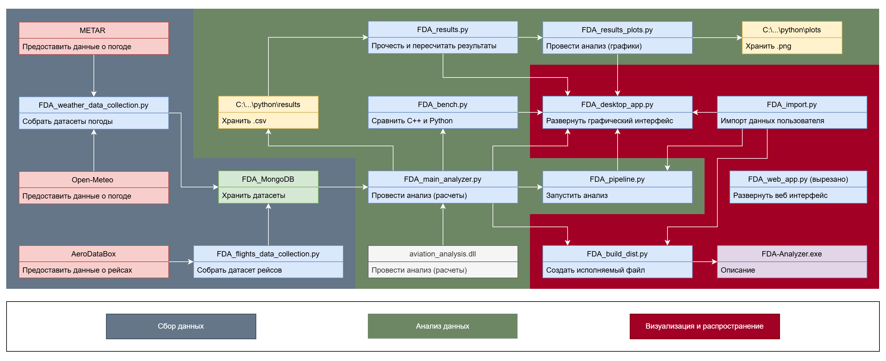

# Flight Delays Analysis

Распределённая система сбора, хранения и высокопроизводительного анализа авиационно-метеорологических данных.

Проект изучает, как погода влияет на задержки и отмены рейсов в аэропортах **Пулково (ULLI)** и **Шереметьево (UUEE)**.
Период исследования: 1 мая – 28 октября 2026 года (180 дней).

## Возможности

- **Сбор данных**: рейсы (AeroDataBox) и погода (Open-Meteo, METAR Iowa Mesonet) сохраняются в MongoDB.
- **Анализ**: почасовой датасет, статические и скользящие корреляции Пирсона (окна 24 и 168 часов) между погодой и долей задержек, отменами, средней задержкой.
- **Высокопроизводительное ядро** на C++ (OpenMP, SIMD, MPI) с вызовом из Python через `ctypes`; есть чисто Python/NumPy-эталон для сверки.
- **Бенчмарк**: сравнение C++, NumPy и чистого Python по времени, ускорению, точности и масштабированию по потокам.
- **Графики и отчёты** (`.png`, `.pdf`, `.svg`).
- **Графическое приложение FDA Analyzer** (Tkinter + matplotlib) с импортом собственных CSV и сборка в `.exe` (PyInstaller).

## Структура репозитория

```
├── cpp/                 C++ библиотека aviation_analysis (CMake)
│   ├── include/         заголовок aviation_analysis.h
│   ├── src/             реализация (скользящая корреляция, предобработка)
│   └── tests/           юнит-тесты ядра (CTest + MPI)
├── python/              сборщики данных, анализ, графики, GUI, сборка дистрибутива
├── dataset/             синтетические примеры датасетов для проверки анализа
├── structure/           диаграмма архитектуры (diagram.drawio, diagram.png)
├── .gitignore
└── README.md
```

### Модули Python (`python/`)

| Файл | Назначение |
|---|---|
| `FDA_weather_data_collection.py` | Сбор погоды (Open-Meteo, METAR) → MongoDB, экспорт в CSV |
| `FDA_flights_data_collection.py` | Сбор рейсов через AeroDataBox (RapidAPI) → MongoDB |
| `FDA_main_analyzer.py` | Головной расчёт: почасовой датасет и корреляции (C++ или Python) |
| `FDA_pipeline.py` | Запуск анализа на данных пользователя, служебные пути |
| `FDA_import.py` | Импорт собственных CSV в почасовой датасет |
| `FDA_results.py` | Чтение и пересчёт результатов |
| `FDA_results_plots.py` | Построение графиков по результатам |
| `FDA_bench.py` | Бенчмарк C++ и Python |
| `FDA_desktop_app.py` | Графический интерфейс (3 вкладки: анализ, результаты, производительность) |
| `FDA_build_dist.py` | Сборка дистрибутива `FDA-Analyzer.exe` |

Схема взаимодействия модулей: [`structure/diagram.png`](structure/diagram.png) (исходник для draw.io: `structure/diagram.drawio`).



## Требования

- Python 3.9+ и пакеты: `numpy`, `pandas`, `matplotlib`, `requests`, `pymongo` (Tkinter входит в стандартную поставку Python); для сборки `.exe` дополнительно `pyinstaller`
- Компилятор C++14, CMake ≥ 3.20, OpenMP и MPI (MS-MPI / OpenMPI) — только для сборки C++ библиотеки
- MongoDB — только для сбора данных и расчёта по собранным данным (не нужна для работы с CSV из `dataset/`)

```bash
pip install numpy pandas matplotlib requests pymongo
```

## Сборка C++ библиотеки

```bash
cd cpp
cmake -S . -B build -DCMAKE_BUILD_TYPE=Release
cmake --build build --config Release
ctest --test-dir build -C Release     # юнит-тесты
```

В результате появляется `aviation_analysis.dll` (Windows) или `libaviation_analysis.so` (Linux). Анализатор ищет библиотеку автоматически; путь можно задать ключом `--lib`. Если библиотеки нет, используется Python-бэкенд.

## Быстрый старт

Самый простой путь — попробовать приложение на примерах из `dataset/` (данные синтетические, не реальные):

```bash
cd python
python FDA_desktop_app.py
```

На вкладке «Анализ своих данных» выберите `dataset/example_hourly.csv` (один файл, строка = час) либо набор `example_weather.csv` + `example_flights.csv` (+ `example_metar.csv`). Форматы столбцов описаны в [`dataset/README_examples.txt`](dataset/README_examples.txt).

## Полный цикл на реальных данных

Все команды запускаются из папки `python/`.

**1. Настройка окружения**

```bash
export RAPIDAPI_KEY=...                       # ключ AeroDataBox; не хранить в коде и не коммитить
export MONGO_URI=mongodb://localhost:27017    # либо MONGO_HOST=<имя хоста>; по умолчанию localhost
```

**2. Сбор данных**

```bash
python FDA_weather_data_collection.py --dry-run    # только план
python FDA_weather_data_collection.py              # скачать погоду и импортировать в MongoDB
python FDA_flights_data_collection.py --dry-run    # план и оценка расхода units API
python FDA_flights_data_collection.py              # скачать рейсы и импортировать в MongoDB
```

Сырые ответы кэшируются в `raw_weather/` и `raw_aerodatabox/` (в Git не попадают). Ключ `--import-only` пересобирает MongoDB из кэша.

**3. Анализ**

```bash
python FDA_main_analyzer.py                                  # оба аэропорта, окна 24 и 168 часов
python FDA_main_analyzer.py --airport ULLI --windows 24,72   # свой аэропорт и окна
python FDA_main_analyzer.py --backend python                 # без C++ библиотеки
python FDA_main_analyzer.py --verify                         # сверить C++ и Python-эталон
```

Результаты сохраняются в `results/` (`hourly_dataset_*.csv`, `correlations_static_*.csv`, `rolling_*.csv`, `run_info.json`). Дополнительные ключи: `--direction`, `--delay-field`, `--min-flights`, `--exclude-cargo`, `--include-codeshare`.

**4. Графики**

```bash
python FDA_results_plots.py --results-dir results --format png
```

Графики сохраняются в `plots/`. Доступные виды: `static`, `rolling`, `summary`, `binned`, `flags`, `lag`, `profile`, `daily` (параметр `--only`).

**5. Сборка дистрибутива (Windows)**

```bash
pip install pyinstaller
python FDA_build_dist.py --lib ..\cpp\build\Release\aviation_analysis.dll ^
                         --author-results results --author-benchmark benchmarks\benchmark_XXXX.csv
```

Результат: `dist/FDA-Analyzer/` и `dist/FDA-Analyzer.zip`. Для проверки путей без PyInstaller используйте `--dry-run`.

## Данные

| Источник | Что даёт |
|---|---|
| [AeroDataBox](https://rapidapi.com/aedbx-aedbx/api/aerodatabox) (RapidAPI) | Расписание и фактическое время рейсов ULLI и UUEE |
| [Open-Meteo Archive](https://open-meteo.com/) | Температура, влажность, осадки, снегопад, ветер и порывы, облачность |
| [Iowa Environmental Mesonet](https://mesonet.agron.iastate.edu/) (METAR) | Видимость и нижняя граница облаков |

Файлы в `dataset/` — **синтетические примеры** для знакомства с форматами, они не отражают реальную статистику.

## Ограничения

Корреляция не доказывает причинность; почасовые наблюдения автокоррелированы, поэтому значимость скользящих корреляций следует интерпретировать осторожно.

## Статус

Веб-интерфейс (`FDA_web_app.py`) исключён из текущей версии; доступен графический интерфейс на Tkinter.
