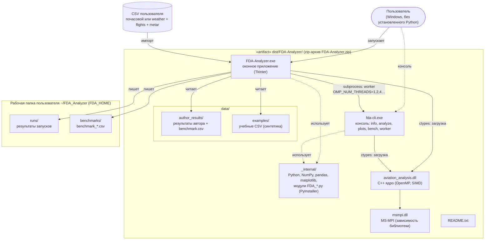
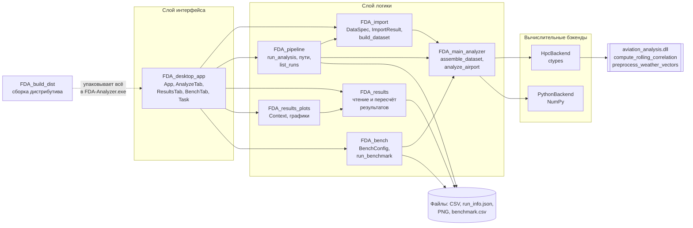
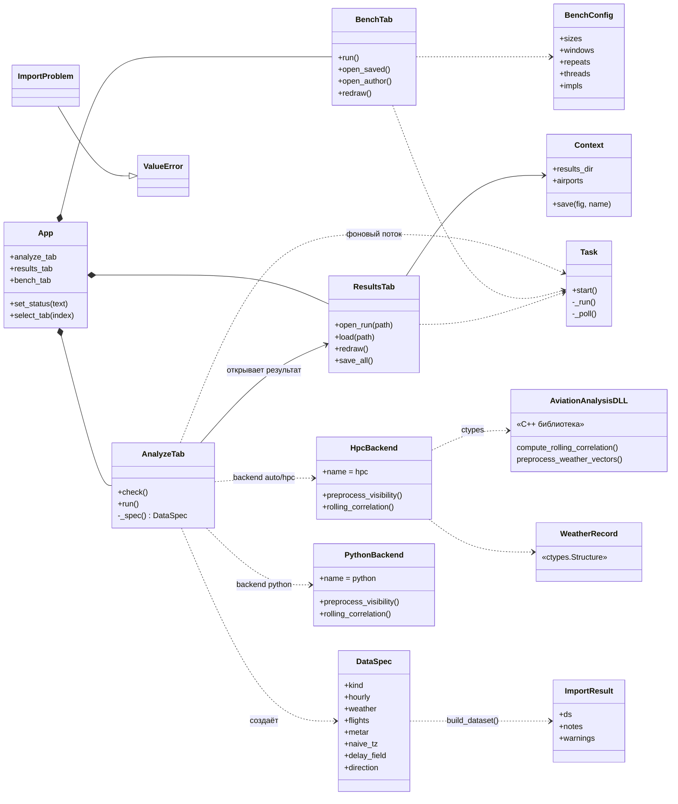
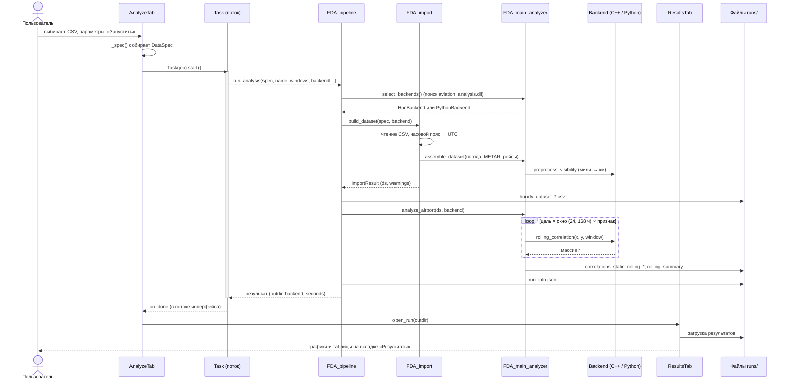
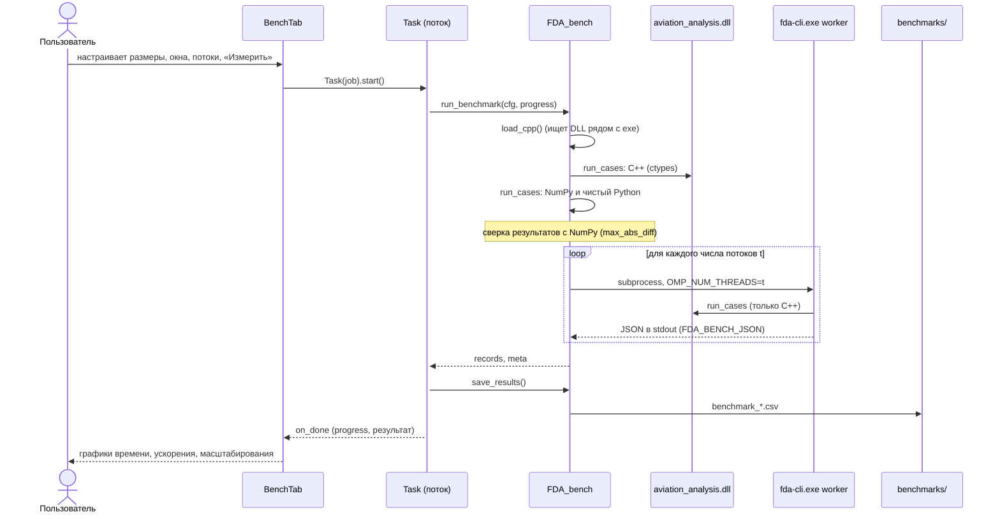

# UML-диаграммы: работа дистрибутива FDA-Analyzer.exe

Диаграммы описывают архитектуру решения и работу собранного приложения `FDA-Analyzer` (issue #9).
Исходники в формате Mermaid лежат в [`uml/*.mmd`](uml), готовые изображения в [`uml/*.png`](uml).
GitHub рисует блоки Mermaid прямо на этой странице.

## 1. Диаграмма развёртывания: состав дистрибутива

Что входит в `dist/FDA-Analyzer/` (его собирает `FDA_build_dist.py`) и как части взаимодействуют на компьютере пользователя.

## 2. Диаграмма компонентов: модули и зависимости

## 3. Диаграмма классов

## 4. Диаграмма последовательности: анализ своих данных

Вкладка «Анализ своих данных»: от нажатия «Запустить» до отображения результатов.

## 5. Диаграмма последовательности: бенчмарк C++ и Python

Вкладка «Производительность»: для масштабирования по потокам OpenMP каждое значение измеряется в отдельном процессе `fda-cli.exe worker`.

