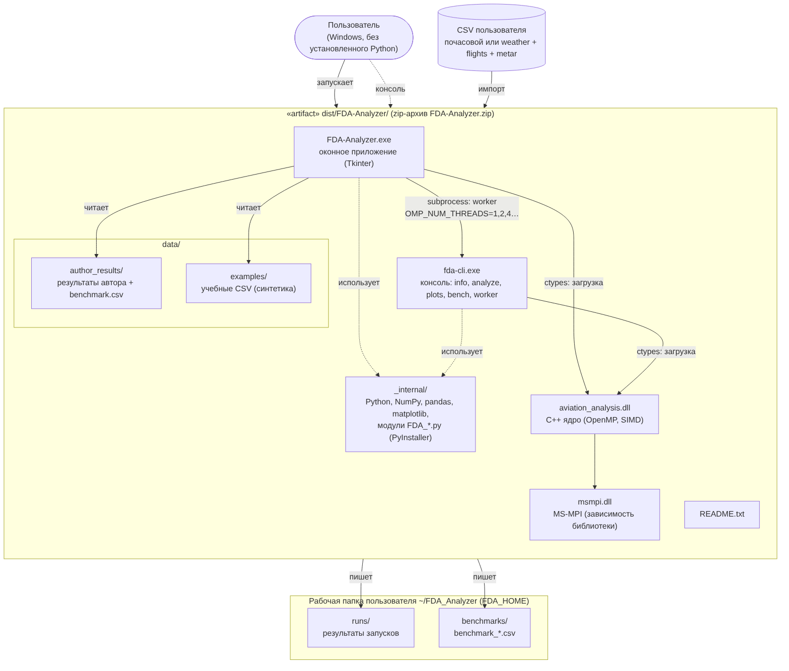

# UML-диаграммы: работа дистрибутива FDA-Analyzer.exe

Диаграммы описывают архитектуру решения и работу собранного приложения `FDA-Analyzer`.

## 1. Диаграмма развёртывания: состав дистрибутива

## 2. Диаграмма компонентов: модули и зависимости

## 3. Диаграмма классов

## 4. Диаграмма последовательности: анализ своих данных

## 5. Диаграмма последовательности: бенчмарк C++ и Python

